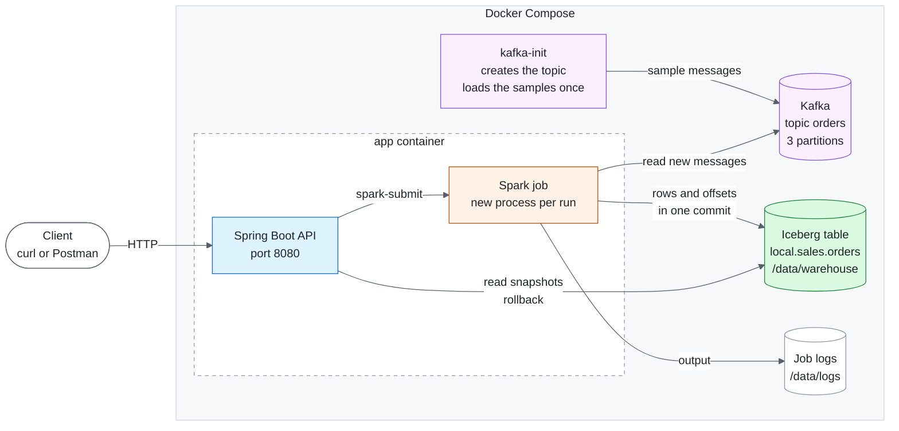

# Order Ingestion Job

A REST API launches Spark batch jobs to ingest new order messages from Kafka into Iceberg.
Each row includes the Kafka timestamp and the run's `run_ts`. Data and Kafka offsets are
committed together in one snapshot, which also supports run history and rollback with replay.

## Tech stack

| Component | Technology |
|---|---|
| API | Java 17, Spring Boot 3.5.6 |
| Processing | Scala 2.12, Apache Spark 3.5.9 |
| Messaging | Apache Kafka 4.1.2 (KRaft) |
| Storage | Apache Iceberg 1.10.0, Hadoop catalog |
| Build and runtime | Maven, Docker Compose; Spark in local mode |

## How to run

Requires Docker with Docker Compose.

```bash
git clone https://github.com/alsubaie-os/order-ingestion-job-app.git && cd order-ingestion-job-app
docker compose up --build -d
```

Compose starts Kafka, loads the 10,000 sample messages into the `orders` topic, and starts the API on
`http://localhost:8080`. If Compose asks to allow `network.host` for the build, answer `y`.
`docker compose down -v` resets everything: the Kafka messages, the table and the job logs.

## Architecture



### How it works

1. `POST /jobs` starts the Spark job as a separate process. Only one job runs at a time.
2. The job reads the last saved Kafka offsets from the table and loads only newer messages.
3. Each row gets `run_ts` and the Kafka timestamp. Bad messages are counted and skipped.
4. Rows and offsets are saved in one Iceberg commit, so a failed run can simply run again.
5. A rollback restores an older snapshot with its offsets, so the next run reloads the later messages.

## APIs

| Endpoint | Purpose |
|---|---|
| `POST /jobs` | Starts an asynchronous Spark ingestion run. |
| `GET /jobs/{runTs}` | Returns job status (`RUNNING`, `SUCCEEDED`, `FAILED`) and available results. |
| `GET /runs` | Lists committed runs from Iceberg snapshots, including row counts and Kafka offsets. |
| `POST /runs/rollback/{snapshotId}` | Restores an earlier snapshot and its offsets so the next run replays subsequent messages. |

### Sample requests and responses

Start a job: `202 Accepted`, with the header `Location: /jobs/{runTs}`.

```bash
curl -X POST http://localhost:8080/jobs
```

```json
{
  "runTs": "2026-10-11T09:15:02.481Z",
  "status": "RUNNING",
  "startedAt": "2026-10-11T09:15:02.483417Z",
  "logFile": "/data/logs/run-2026-10-11T09-15-02.481Z.log"
}
```

Check the job: `200 OK`. The `runTs` is the job id.

```bash
curl http://localhost:8080/jobs/2026-10-11T09:15:02.481Z
```

```json
{
  "runTs": "2026-10-11T09:15:02.481Z",
  "status": "SUCCEEDED",
  "startedAt": "2026-10-11T09:15:02.483417Z",
  "finishedAt": "2026-10-11T09:15:44.910532Z",
  "exitCode": 0,
  "snapshotId": 5481049402364929337,
  "rowsAdded": 9999,
  "rowsRejected": 1,
  "logFile": "/data/logs/run-2026-10-11T09-15-02.481Z.log"
}
```

Run history: `200 OK`, oldest run first.

```bash
curl http://localhost:8080/runs
```

```json
[
  {
    "runTs": "2026-10-11T09:15:02.481Z",
    "snapshotId": 5481049402364929337,
    "parentSnapshotId": null,
    "committedAt": "2026-10-11T09:15:41.127Z",
    "rowsAdded": 9999,
    "rowsRejected": 1,
    "kafkaOffsets": { "orders": { "0": 3390, "1": 3274, "2": 3336 } },
    "current": true,
    "rolledBack": false
  }
]
```

Rollback: `200 OK`, with the snapshot that is current now.

```bash
curl -X POST http://localhost:8080/runs/rollback/5481049402364929337
```

```json
{ "snapshotId": 5481049402364929337, "runTs": "2026-10-11T09:15:02.481Z", "totalRows": 9999 }
```

Error structure, for example `409 Conflict`:

```json
{
  "type": "about:blank",
  "title": "Conflict",
  "status": 409,
  "detail": "Run 2026-10-11T09:20:11.204Z is still in progress. Wait for it to finish (GET /jobs/2026-10-11T09:20:11.204Z).",
  "instance": "/jobs"
}
```

## Changes for production

| Area | Today | In production |
|---|---|---|
| Spark | `local[*]` inside the API container | A Spark cluster (Kubernetes or EMR). The API only submits and tracks jobs |
| Iceberg catalog | Hadoop catalog on a Docker volume | REST or Glue catalog on S3. The Hadoop catalog is not safe on object storage |
| Job status and lock | In memory, one API instance | A database and a shared lock, so several API instances can run |
| Rejected messages | Only counted | Saved to a dead-letter table with the raw message and the reason |
| Kafka | Local broker, no security, free JSON | The company cluster over TLS and SASL, with a schema registry |
| Operations | Manual `POST /jobs`, logs only | A scheduler such as Airflow, and alerts on failed runs |
| Security | Open API | Authentication, and rollback allowed for operators only |
| Testing | Manual, with Postman | Unit and integration tests in CI |

## What is not finished

- No automated tests in the repository. The API was tested with a Postman collection kept outside it.
- Job status is kept in memory, so `GET /jobs/{runTs}` forgets jobs after an API restart. `GET /runs` keeps the full history.
- Rejected messages are counted but not stored.
- Tested on Linux only (GitHub Codespaces).

## Assumptions

- Messages are JSON with six required fields (`orderId`, `customerId`, `amount`, `currency`, `status`, `eventTime`). Values are stored as received.
- Each Kafka message is loaded once. The same order sent twice is stored twice.
- Only this job writes to the table, and only one API instance runs.
- The sample loader expects a new `orders` topic with no other producers.
